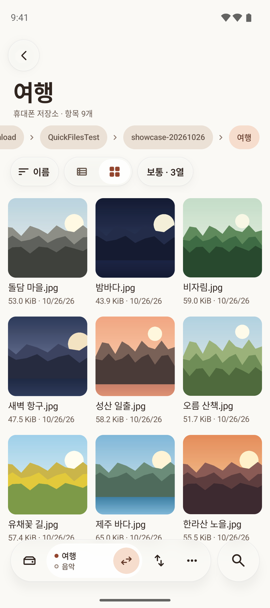
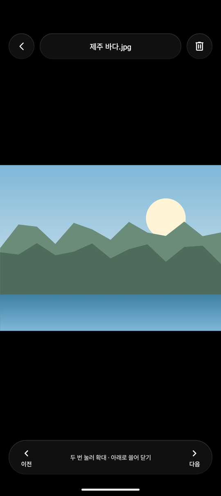
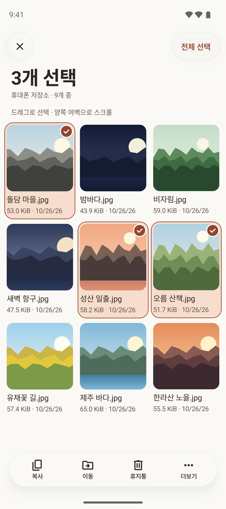
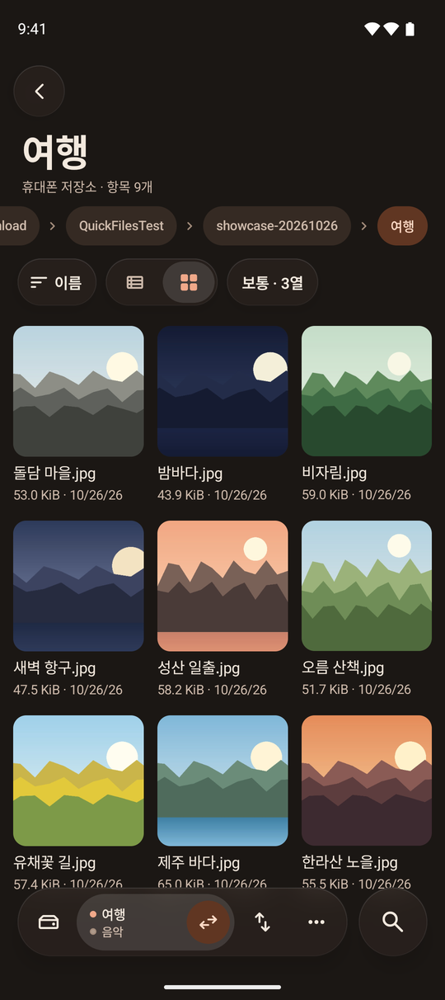

<p align="center">
  
</p>

<h1 align="center">곳간</h1>

<p align="center">
  휴대폰 저장소와 WebDAV를 위한 Android 파일관리자.<br>
  <a href="README.md">English</a>
</p>

<p align="center">
  <a href="https://github.com/soira237-risu/gotgan/actions/workflows/android.yml"></a>
  <a href="LICENSE"></a>
  
</p>

<p align="center">
  
  
  
  
</p>

## 기능

- 휴대폰 저장소와 WebDAV(HTTPS)
- 검증하는 복사·이동, 작업 대기열
- 복원되는 휴지통
- 이미지·텍스트·PDF·ZIP/CBZ 뷰어
- 백그라운드 재생과 PiP
- 색상 테마 6종, 어둡게·OLED

## 빌드

JDK 17과 Android SDK 36이 필요합니다.

```sh
./gradlew assembleDebug
```

## 라이선스

[MIT](LICENSE)
