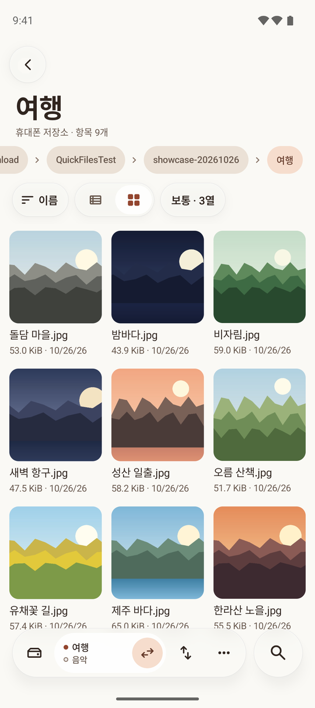
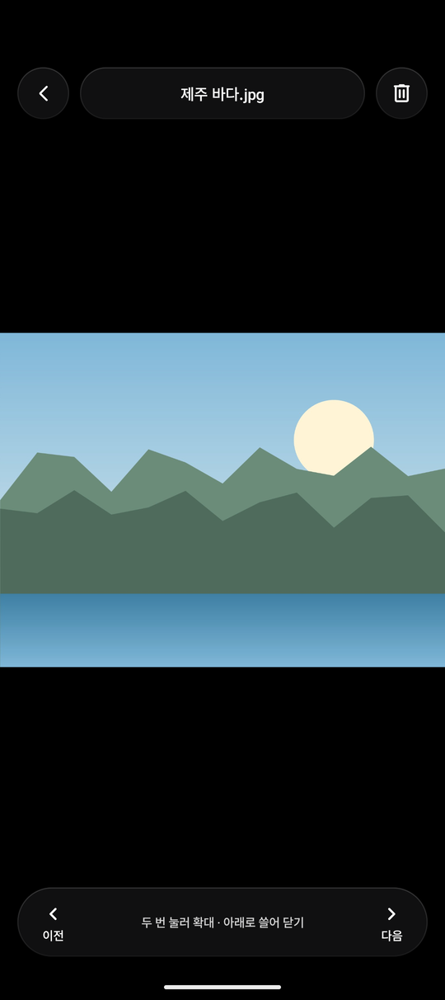
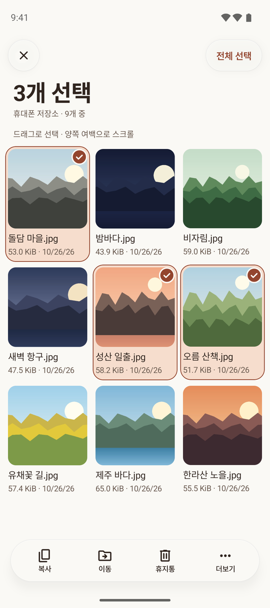
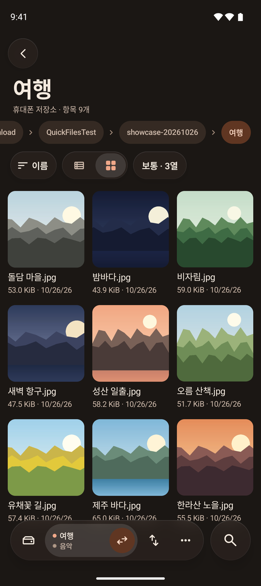

<p align="center">
  
</p>

<h1 align="center">Gotgan</h1>

<p align="center">
  Android file manager for phone storage and WebDAV.<br>
  <a href="README.ko.md">한국어</a>
</p>

<p align="center">
  <a href="https://github.com/soira237-risu/gotgan/actions/workflows/android.yml"></a>
  <a href="LICENSE"></a>
  
</p>

<p align="center">
  
  
  
  
</p>

## Features

- Phone storage and WebDAV (HTTPS)
- Verified copy and move, task queue
- Trash with restore
- Image, text, PDF and ZIP/CBZ viewers
- Background media and picture-in-picture, including camcorder .mts/.m2ts and AC-3/DTS audio via FFmpeg
- Six color themes, dark and OLED

## Build

Requires JDK 17 and Android SDK 36.

```sh
./gradlew assembleDebug
```

## Release signing

Pushing a `vX.Y.Z` tag runs [release.yml](.github/workflows/release.yml): it builds the R8-minified release APK with versionName `X.Y.Z` and versionCode `X*10000 + Y*100 + Z` (Y and Z 0-99, first tag v1.0.1 or later), signs it and publishes it with a SHA-256 file as a GitHub Release. Without the secrets below the workflow still builds and checks the APK, keeps it as a workflow artifact signed with the runner's debug key, and skips the Release.

| Repository secret | Value |
| --- | --- |
| `GOTGAN_KEYSTORE_BASE64` | the keystore file, base64 encoded |
| `GOTGAN_KEYSTORE_PASSWORD` | keystore password |
| `GOTGAN_KEY_ALIAS` | key alias |
| `GOTGAN_KEY_PASSWORD` | key password |

Create a new key (Android cannot update an app signed with a different key, so installs signed with the old key need one reinstall):

```sh
keytool -genkeypair -v -keystore gotgan-release.jks -storetype PKCS12 \
  -alias gotgan -keyalg RSA -keysize 4096 -validity 10000
base64 -w0 gotgan-release.jks > gotgan-release.jks.b64   # macOS: base64 -i gotgan-release.jks
```

Or keep updating existing installs by using the key that signed them, for example the project debug key: `.android/debug.keystore`, alias `androiddebugkey`, both passwords `android`.

Register the secrets under Settings > Secrets and variables > Actions, or with the GitHub CLI:

```sh
gh secret set GOTGAN_KEYSTORE_BASE64 < gotgan-release.jks.b64
gh secret set GOTGAN_KEYSTORE_PASSWORD
gh secret set GOTGAN_KEY_ALIAS --body gotgan
gh secret set GOTGAN_KEY_PASSWORD
```

Then release with `git tag v1.0.1 && git push origin v1.0.1`. Keep the keystore and passwords backed up outside the repository; a lost key means users must reinstall. Every release also uploads its R8 `mapping.txt` as a workflow artifact for reading obfuscated stack traces.

Locally, `./gradlew assembleRelease` signs with the same key when an untracked `keystore.properties` in the project root has `storeFile`, `storePassword`, `keyAlias` and `keyPassword` (or the `GOTGAN_KEYSTORE_FILE`, `GOTGAN_KEYSTORE_PASSWORD`, `GOTGAN_KEY_ALIAS`, `GOTGAN_KEY_PASSWORD` environment variables are set); otherwise it uses the debug key.

## License

[MIT](LICENSE)

The app's own source is MIT. Built APKs bundle [NextLib](https://github.com/anilbeesetti/nextlib) FFmpeg decoders, which are GPL-3.0, so a distributed APK as a whole follows GPL-3.0.
